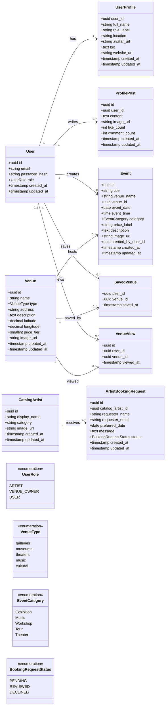

# Database UML (Entities)

## Schema Notes

- Scope:
  - Covers only currently implemented frontend workflows: auth, profile editing, profile posts, discover events, map saved/recent venues, and catalog booking requests.
  - Excludes roadmap-only features (payments, venue booking lifecycle, ratings/community feed wiring).
- Core constraints:
  - `user.email` must be unique.
  - `user_profile.user_id` is both PK and FK to `user.id` (1:1).
  - `saved_venue` uses a composite PK (`user_id`, `venue_id`) to prevent duplicate saves.
  - `event.venue_id` is nullable, but `event.venue_name` is required.
  - `profile_post.content` must be non-empty after trim.
  - `event.title` and `event.venue_name` must be non-empty after trim.
  - `artist_booking_request.requester_email` must pass email-format validation.
  - `venue.price_tier` should be constrained to a small bounded range (for example `0..3`).
- Referential behavior:
  - `profile_post.user_id`, `saved_venue.user_id`, `venue_view.user_id`, and `event.created_by_user_id` reference `user.id`.
  - `saved_venue.venue_id`, `venue_view.venue_id`, and optional `event.venue_id` reference `venue.id`.
  - `artist_booking_request.catalog_artist_id` references `catalog_artist.id`.
- Index recommendations for active UI queries:
  - `event(category, event_date)`.
  - `event(lower(title))`.
  - `event(lower(venue_name))`.
  - `venue(type)`.
  - `venue(lower(name))`.
  - `profile_post(user_id, created_at desc)`.
  - `saved_venue(user_id, saved_at desc)`.
  - `venue_view(user_id, viewed_at desc)`.
  - `artist_booking_request(catalog_artist_id, created_at desc)`.
- API compatibility notes:
  - Frontend display strings like `savedDate` and `viewedDate` (for example "Today", "2 days ago") should be derived from timestamps, not stored.
  - Event card ownership fields (`createdByName`, `createdByEmail`) can be returned as denormalized response fields from joins over `user`/`user_profile`; they do not need dedicated columns in `event`.
